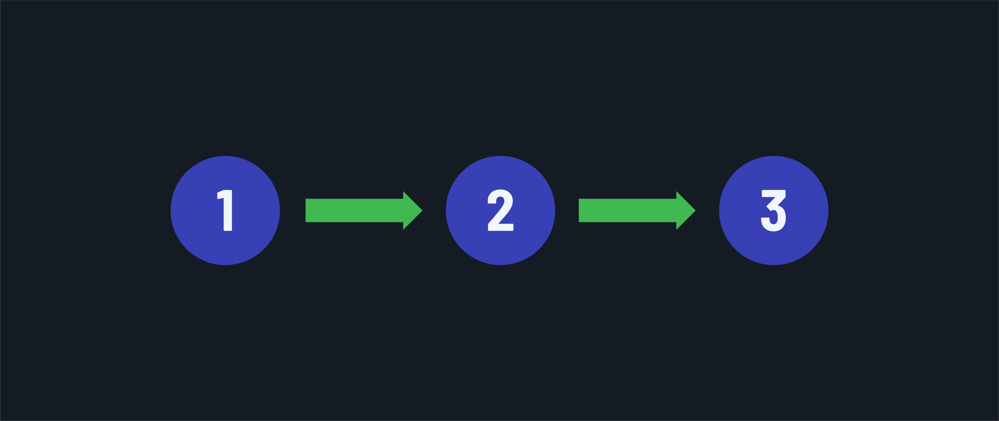
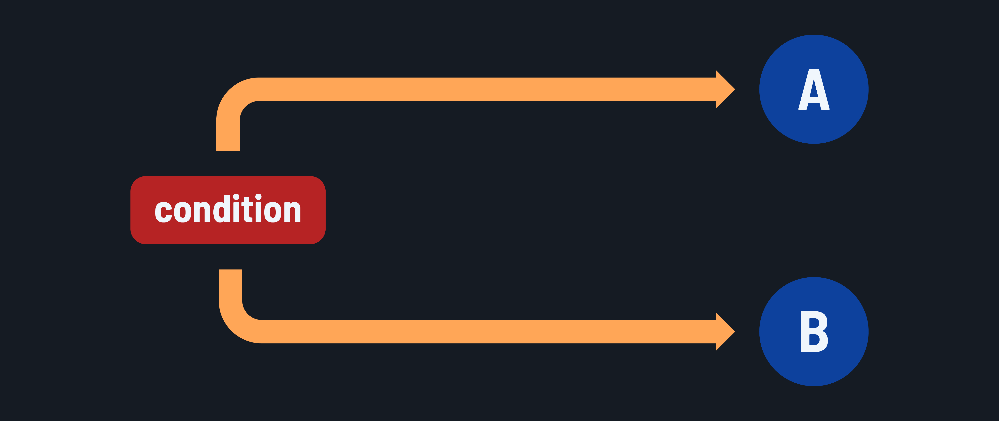
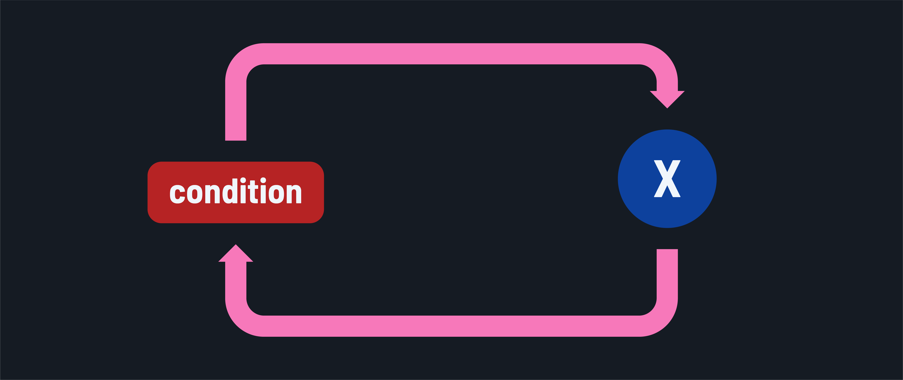

<h1>
  Java Control Flow
  Concepts
</h1>

**Learning objective:** By the end of this lesson, you'll be able to define and distinguish different types of control flows in computer programs.

## What is control flow?

In Java, control flow refers to the sequence in which individual statements, instructions, or function calls are executed or evaluated. Java provides various [control flow constructs](https://docs.oracle.com/javase/tutorial/java/nutsandbolts/flow.html) to enable developers to define the logical flow of a program.

### Sequential flow

The default execution flow for almost all programming languages is sequential. Sequential execution flow occurs when a program's statements are executed from top to bottom in the order they appear. However, this sequential flow can be manipulated to branch or loop using control flow statements.

### Branching

Branching is achieved when the execution of a program is transferred from one statement to another statement anywhere else in the program other than the subsequent line. When the execution flow is transferred by evaluating whether a certain condition is met, such control flow manipulation is called **conditional branching**. When the execution is transferred without those evaluations, it is called **unconditional branching**.

### Looping

Looping refers to the process of executing a block of code repeatedly, either for a specified number of times or until a specific condition is met. Looping helps programmers to write efficient code by removing the need to write redundant code.
