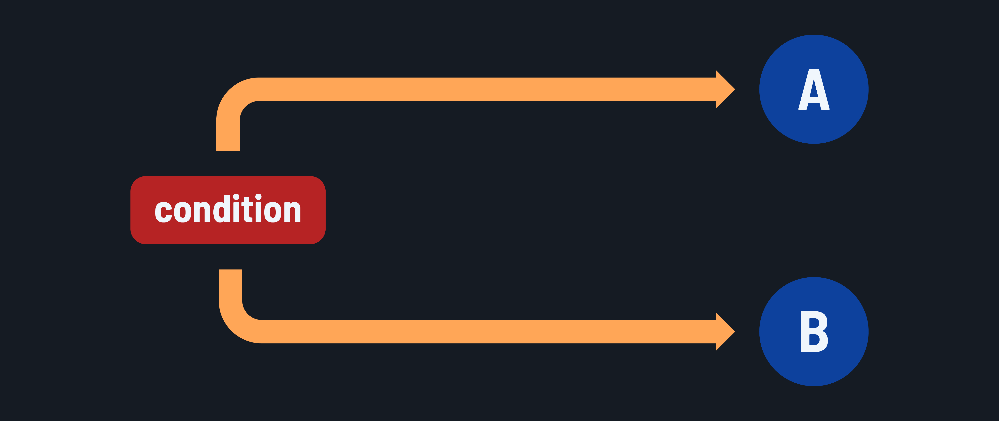

<h1>
  <span class="headline">Java Control Flow</span>
  <span class="subhead">Conditional Branching Statements</span>
</h1>

**Learning objective:** By the end of this lesson, you'll be able to compose conditional branching statements in Java, allowing you to create decision paths.

## Java block statements

Before we dive into conditional branching, let's quickly discuss block statements in Java.

A block statement in Java is a group of zero or more statements enclosed within curly braces `{}`. It combines multiple statements into a single unit or **scope**. Variables declared inside a block are local to the block and cannot be accessed outside of it.

Syntax:

```java
{
    // Statements go here
    statement1;
    statement2;
    // and so on...
}
```

Understanding statement blocks helps you organize your code into reusable, logical sections, improving readability and debugging efficiency. It's the foundation of structured programming. In the context of Java control flow manipulation, block statements gather all the statements that represent an independent branch to be executed conditionally or iterated repetitively.

## An introduction to conditional branching control flow



Conditional branching statements in Java allow a program to execute specific **block statements** based on conditions. These statements evaluate expressions using conditional operators and decide which code path to execute based on the result. The conditional branching options in Java are:

- `if` statement
- `if-else` statement
- `if-else-if` ladder
- `switch` statement

## `if` Statement

The `if` statement executes a block statement only if a condition evaluates to true. It is used for simple 'to execute or not to execute' scenarios.

Syntax:

```java
if (condition) {
    // Statements to execute if the condition is true
}
```

Example: Check if a store is open based on the current hour. Also determine if it is morning.

```java
int hour = 14; // Current hour in 24-hour format.

if (hour >= 9 && hour <= 21) {
    System.out.println("The store is open.");
    // Prints: The store is open.
}

if (hour < 12) {
    System.out.println("It is morning.");
    // Not executed, so nothing prints. 
}
```

> 🧠 You may be used to the concept of truthy and falsey values in other programming languages. Java doesn't have this same exact idea because it won't allow for automatic conversion of types. All boolean conditions must explicitly evaluate to `true` or `false`.

## `if-else` statement

The `if-else` statement executes one block of code if the condition is true or a different block if it is false. It is used for either-or branching scenarios.

Syntax:

```java
if (condition) {
    // Statements to execute if the condition is true
} else {
    // Statements to execute if the condition is false
}
```

Example: Check if it is morning or afternoon.

```java
int hour = 14;

if (hour < 12) {
    System.out.println("It is morning.");
    // Not executed, so nothing prints.
} else {
    System.out.println("It is afternoon.");
    // Prints: It is afternoon.
}
```

## `if-else-if` ladder

The `if-else-if` ladder creates three or more possible paths, each with different conditions. Only one block of code will be executed.

In this ladder, the conditional expression of each `if`/`else if` rung is evaluated in sequence until one is `true`. It is used for multiple control flow branching scenarios, each based on its own Boolean expression evaluation.

Optionally, a final `else` statement block can be executed if the `if` statement and all the `else if` statements are evaluated as `false`.

Syntax:

```java
if (condition1) {
    // Code to execute if condition1 is true
} else if (condition2) {
    // Code to execute if condition2 is true
} else {
    // Code to execute if all conditions are false
}
```

Example: Categorizing a person's age group

```java
int age = 25;

if (age < 13) {
    System.out.println("Child");
    // Not executed, so nothing prints.
} else if (age < 20) {
    System.out.println("Teenager");
    // Not executed, so nothing prints.
} else if (age < 60) {
    System.out.println("Adult");
    // Prints: Adult
} else {
    System.out.println("Senior");
    // Not executed, so nothing prints.
}
```

Order is important when constructing a ladder. Consider this code:

```java
int age = 6;

if (age < 60) {
    System.out.println("Adult");
    // Prints: Adult
} else if (age < 20) {
    System.out.println("Teenager");
    // Not executed, so nothing prints.
} else if (age < 13) {
    System.out.println("Child");
    // Not executed, so nothing prints.
} else {
    System.out.println("Senior");
    // Not executed, so nothing prints.
}
```

These code paths:

```java
else if (age < 20) {
    System.out.println("Teenager");
} else if (age < 13) {
    System.out.println("Child");
}
```

Would never be executed because nothing will meet these conditions that don't also meet the first `age < 60` condition.

## `switch` statement

The switch statement evaluates a variable and matches its value against multiple cases, executing the corresponding `case` statement block. The `default` statement block is executed if there is no matching `case`. It is used for multiple control flow branching scenarios based on a single variable's value.

Syntax:

```java
switch (variable) {
    case value1:
        // Code to execute if variable == value1
        break;
    case value2:
        // Code to execute if variable == value2
        break;
    // Additional cases...
    default:
        // Code to execute if no cases match
}
```

Example: Deciding the type of coffee based on the order number entered in a coffee machine.

```java
int orderNumber = 2;

switch (orderNumber) {
    case 1:
        System.out.println("Espresso");
        break;
    case 2:
        System.out.println("Latte");
        break;
    case 3:
        System.out.println("Cappuccino");
        break;
    default:
        System.out.println("Unknown order");
}
// Prints: Latte
```

In this case, the switch statement compares `orderNumber` to each case (`1`, `2`, and `3`) and evaluates the expressions beneath them if there's a match. It uses `==` in the case of primitives like integers, to evaluate equality.

The `default` clause is optional.

### `break;`

Breaks are critical. If you don't include a `break` statement, the code in the following cases will be evaluated, causing unintended consequences.

For example, if you eliminate the break statements from the example above:

```java
int orderNumber = 2;

switch (orderNumber) {
    case 1:
        System.out.println("Espresso");
    case 2:
        System.out.println("Latte");
    case 3:
        System.out.println("Cappuccino");
    default:
        System.out.println("Unknown order");
}
```

The result would be:

```plaintext
Latte
Cappuccino
Unknown order
```

This isn't what we intended.
