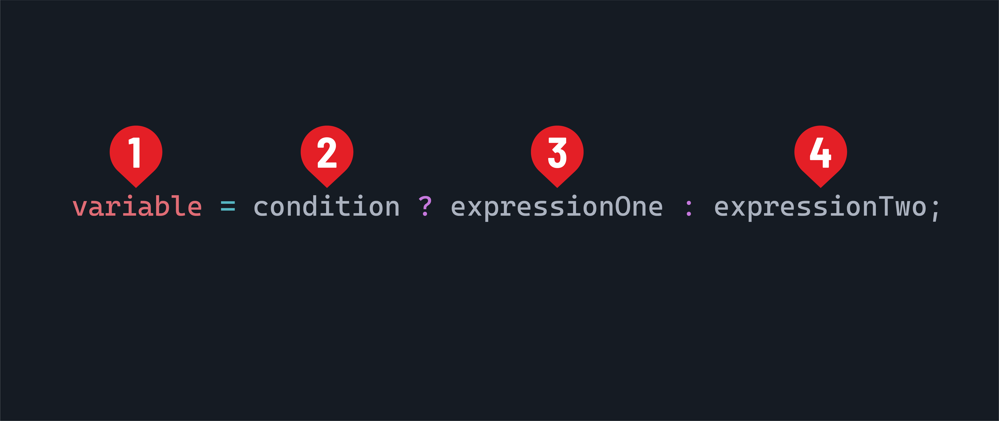

<h1>
  <span class="headline">Java Control Flow</span>
  <span class="subhead">Conditional Operators</span>
</h1>

**Learning objective:** By the end of this lesson, you'll be able to write Java code utilizing comparison and boolean operators.

## An introduction to conditional operators

Operators are special symbols that perform specific operations on one, two, or three operands and then return a result. Conditional operators evaluate conditions and make decisions based on Boolean logic. In other words, after performing the required operation on their operands, conditional operators return the result as a boolean value of `true` or `false`. Conditional operators make conditional branching and condition-based iterating of loops possible.

## Types of conditional operators

There are three types of conditional operators in Java:

- Relational/Comparison operators
- Logical/Boolean operators
- Ternary operator

## Relational/Comparison operators

Relational or comparison operators in Java compare two values and return a Boolean result.

> 📚 Below, *LHS* stands for any expression on the *left-hand side* of the operator, and *RHS* stands for any expression on the operator's *right-hand side*.

| Operator | Operator Description                     |
|:--------:|:-----------------------------------------|
|   `==`   | Is LHS **equal to** RHS?                 |
|   `!=`   | Is LHS **not equal** to RHS?             |
|   `<`    | Is LHS **less than** RHS?                |
|   `>`    | Is LHS **greater than** RHS?             |
|   `<=`   | Is LHS **less than or equal to** RHS?    |
|   `>=`   | Is LHS **greater than or equal to** RHS? |

Let's better understand these relational/comparison operators through a few examples.

### Example 1

Verify if two integers are equal:

```java
int x = 10;
int y = 20;
boolean isEqual = (x == y);
System.out.println(isEqual); 
// Prints: false
```

> ⚠ Notice the difference between using `=` as an assignment operator and `==` as a comparison operator.

### Example 2

Verify if two strings are different:

```java
String str1 = "Hello";
String str2 = "World";
boolean isNotEqual = str1 != str2;
System.out.println(isNotEqual);
// Prints: true
```

### Example 3

Verify if a person is a minor:

```java
int age = 16;
boolean isMinor = age < 18;
System.out.println(isMinor);
// Prints: true
```

### Example 4

Verify if a person has got enough points to qualify for a reward:

```java
int points = 120;
int requiredPoints = 100;
boolean qualifiesForReward = points >= requiredPoints;
System.out.println(qualifiesForReward);
// Prints: true
```

<div class="activity knowledge-check">
  <h3 class="title">Comparison operator outputs</h3>
  <span class="minutes">2 min</span>
</div>

In the following exercises, determine what will be printed to the console.

#### Exercise 1

Determine if we should buy something.

```java
double price = 150.75;
double threshold = 100.00;
boolean isExpensive = price > threshold;
System.out.println(isExpensive);
```

#### Exercise 2

Determine if our luggage will be able to fly on a plane.

```java
int weight = 20;
int maxWeight = 25;
boolean isWithinLimit = weight <= maxWeight;
System.out.println(isWithinLimit);
```

## Logical/Boolean operators

Logical operators in Java allow you to combine or invert Boolean expressions, enabling more complex logic. These operators work on true and false values and return a Boolean result. They are often used in conditional checks but can be applied independently for tasks like data validation or logical comparisons.

| Operator | Operator Description                                                               |
|:--------:|:---------------------------------------------------------------------------------- |
|   `&&`   | Logical AND. Returns `true` if both LHS and RHS expressions are `true`.            |
|  `\|\|`  | Logical OR. Returns `true` if even one of the expressions, LHS or RHS, is `true`.  |
|   `!`    | Logical NOT. Returns the inverted boolean value of the expression that follows it. |

Let's check out a few examples!

### Example 1

Verify that a user inputs a valid username and password before we confirm they are authenticated:

```java
boolean isUsernameCorrect = true;
boolean isPasswordCorrect = false;
boolean isAuthenticated = isUsernameCorrect && isPasswordCorrect;
System.out.println(isAuthenticated);
// Prints: false
```

### Example 2

Negate a condition based on another mutually exclusive condition:

```java
boolean isWeekend = false;
boolean isWeekday = !isWeekend;
System.out.println(isWeekday);
// Prints: true
```

<div class="activity knowledge-check">
  <h3 class="title">Logical operator outputs</h3>
  <span class="minutes">2 min</span>
</div>

In the following exercises, determine what will be printed to the console.

#### Exercise 1

Check if a customer can get a discount:

```java
boolean hasPromoCode = false;
boolean isPrimeMember = true;
boolean eligibleForDiscount = hasPromoCode || isPrimeMember;
System.out.println(eligibleForDiscount);
```

#### Exercise 2

Let's combine more than one logical operation in a single statement:

```java
boolean isEmployee = true;
boolean hasAccessCard = false;
boolean canAccessOffice = isEmployee && !hasAccessCard;
System.out.println(canAccessOffice);
```

#### Exercise 3

What if we combine logical and relational operators?

```java
int age = 25;
boolean isStudent = true;
boolean getsFreeEntry = (age < 18 || age > 60) || isStudent;
System.out.println(getsFreeEntry);
```

## Ternary operator

Let's look at one more conditional operator - the ternary. In Java, the Ternary operator `?` is a shorthand for conditional expressions. It is used solely to evaluate a condition and return an expression. It has this syntax:



1. A variable to create or assign to.
2. The condition to evaluate.
3. If the condition is determined to be `true`, the result of this expression will be assigned to the variable.
4. If the condition is determined to be `false`, the result of this expression will be assigned to the variable.

```java
int speed = 80;
int speedLimit = 60;
String status = (speed >= speedLimit) ? "Speeding" : "Within Limit";
System.out.println(status);
```

## Summary of operators

Oracle's Java documentation has a handy [summary of operators](https://docs.oracle.com/javase/tutorial/java/nutsandbolts/opsummary.html) that may be useful as you're learning this syntax.
