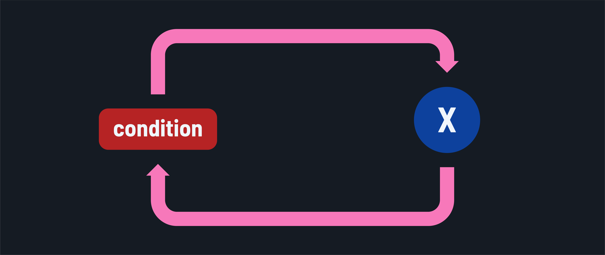

<h1>
  <span class="headline">Java Control Flow</span>
  <span class="subhead">Looping statements</span>
</h1>

**Learning objective:** By the end of this lesson, you'll be able to implement looping constructs in Java to control program flow and execute code blocks repeatedly.

## An introduction to looping control flow



Loops in Java allow repetitive execution of a statement block as long as a condition is met. Java provides three principal looping constructs:

- `for` loops
- `while` loops
- `do-while` loops

> ⚠️ Creating infinite loops that break applications with these constructs is a distinct possibility. Use some caution when working with them!

## `for` loops

A `for` loop is used when the number of iterations has already been determined before beginning the iterations.

Here's the syntax. Notice the placement of the semicolons:

```java
for (initialization; terminationCondition; update) {
    // The loop body. These statements execute on each iteration.
}
```

Let's break down each part with an example that prints the numbers 1 to 5.

```java
for (int i = 1; i <= 5; i++) {
    System.out.println(i);
}
// Output:
// 1
// 2
// 3
// 4
// 5
```

1. Initialization: `int i = 1;`

   - Executed once before any other code.
   - The lifespan of `i` is limited to within the `for` loop. Only the code in this block can access it.

2. Termination condition: `i <= 5;`

   - Executed before each iteration.
   - If it evaluates to `true`, the code in the loop will be executed.
   - If it evaluates to `false`, then the loop will not be executed, and normal control flow will resume.

3. Update: `i++`

   - This is commonly referred to as the increment/decrement step, as those are the common actions carried out here.
   - Executed after the code in the loop body is executed on each iteration.

## `while` loops

A `while` loop is used when the number of iterations can't be determined and depends on a condition.

Here's the `while` loop syntax:

```java
while (condition) {
    // Statement block to execute repeatedly while the condition is true
}
```

Let's implement an example of counting the number of steps taken in a day until the goal of 10,000 steps is reached.

```java
int steps = 0;
int goal = 10000;

while (steps <= goal) {
    steps += 2000; 
    // Simulate taking 2000 steps - realistically, this may be an external service
    System.out.println("Current steps: " + steps);
}
// Prints:
// Current steps: 2000
// Current steps: 4000
// Current steps: 6000
// Current steps: 8000
// Current steps: 10000
```

This simple example isn't the best use case, but it does provide an example of the proper syntax.

## `do-while` loops

A `do-while` loop is used when you need to execute the looped statement block at least once, regardless of the `while` condition. Here's the syntax:

```java
do {
    // Statement block to execute repeatedly
} while (condition);
```

In this example, we'll ask for a password repeatedly until the correct password is entered.

```java
String correctPassword = "java17";
String enteredPassword;
int attempts = 0;

do {
    enteredPassword = "java" + attempts; // Simulate user input
    System.out.println("Attempting with: " + enteredPassword);
    attempts++;
} while (!enteredPassword.equals(correctPassword));

// Prints:
// Attempting with: java0
// Attempting with: java1
// Attempting with: java2
// ...
// Attempting with: java17
```

Note the logical difference between a `do-while` loop and a `while` loop. The code in the body of a `do-while` loop is always executed at least once, regardless of the condition.
