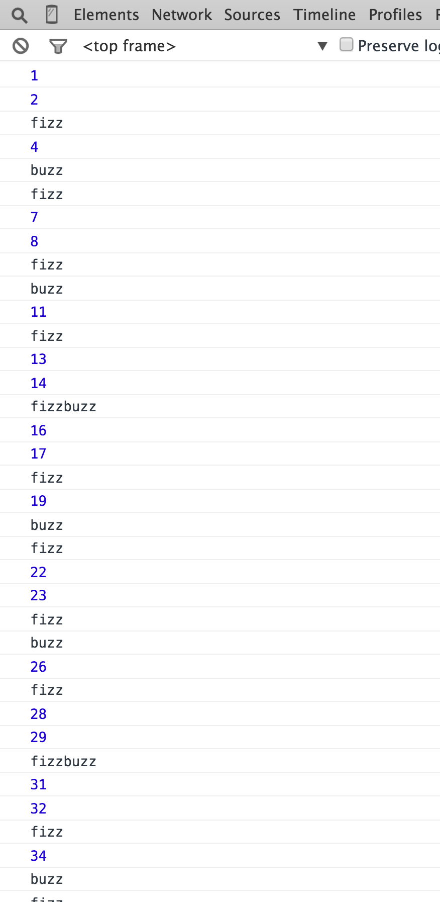

<h1>
  <span class="headline">Java Control Flow</span>
  <span class="subhead">Loops and Fizzbuzz</span>
</h1>

**Learning objective:** By the end of this lesson, students will be able to tktk

## Demo: Loops (15 min)

Looping exists in just about all programming languages. A loop is a statement or block of code that will continue to execute while or until a condition exists.

`while` loops, for example, will run a block of code **while** a condition is `true`. Java has `while` loops,  `do...while` loops, and `for` loops.

The `while` loop is good for basic looping, but there's a possibility it will never run.

> **Knowledge Check**: In what case will the `while` loop never run?

```java
while (true) {
  // an infinite loop!
}
```

Using a `do...while` loop makes sure the body of the loop is executed at least once, because `while` isn't evaluated until after the block of code runs:

```java
int input = 0;

do {
  System.out.println(input++);
} while (input < 10);
```

You can use looping in combination with iteration: a way of incrementally repeating a task.

For example, using a `for` loop:

```java
int iterations = 10;

for (int i = 0; i < iterations; i++) {
  System.out.println(i);
}
```

Notice the placement of the semicolons. Now, let's take a look at what each of the parts do:

1. `int i = 0;` is the **initialization** phase.
   - This is executed once, before the loop begins.
   - Note that `int i` is declared within this phase. This means the lifespan of `i` is limited to within the `for` loop, which is much cleaner and leads to less problems down the line.

2. `i < iterations;` is the **termination** phase.
    - Every time the loop evaluates, it checks this statement.
    - If this statement evaluates to `false`, the loop terminates.
    - This is equivalent to the `while` section of the `do...while` loop.

3. `i++` is the **increment** expression.
    - This happens every time the loop evaluates.
    - This is equivalent to the `do` section of the `do...while` loop.
    - In this case, for each loop, `i` is incremented by `1`.

## Independent Practice: Fizz Buzz (15 min)

Fizz buzz is a game about division. Create a program that will iterate through numbers `1` to `101`, and log each number in the console.

- If the number is divisible by **three**, the word `fizz` should be logged instead of logging the number itself.
- If the number is divisible by **five**, the word `buzz` should be logged.
- If the number is divisible by both **three** and **five**, the word `fizzbuzz` should be logged.

**Hint**: Remember the **modulo** operator?

A typical output would look like this:



```java
for (int i = 1; i < 101; i++) {

  if((i % 3 == 0) && (i % 5 == 0)) {
    System.out.println("fizzbuzz");
  } else if(i % 3 == 0) {
    System.out.println("fizz");
  } else if(i % 5 == 0) {
    System.out.println("buzz");
  } else {
    System.out.println(i);
  }
}
```

## Conclusion (5 min)

These are some of the foundational tools you'll use in many of your applications. You'll probably need to refresh yourself on the exact syntax a few times before you memorize it. But it's important to remember these core control flow concepts, because they'll come up in almost every programming language you'll encounter. The Java documentation on [control flow statements](https://docs.oracle.com/javase/tutorial/java/nutsandbolts/flow.html) is a helpful reference.
